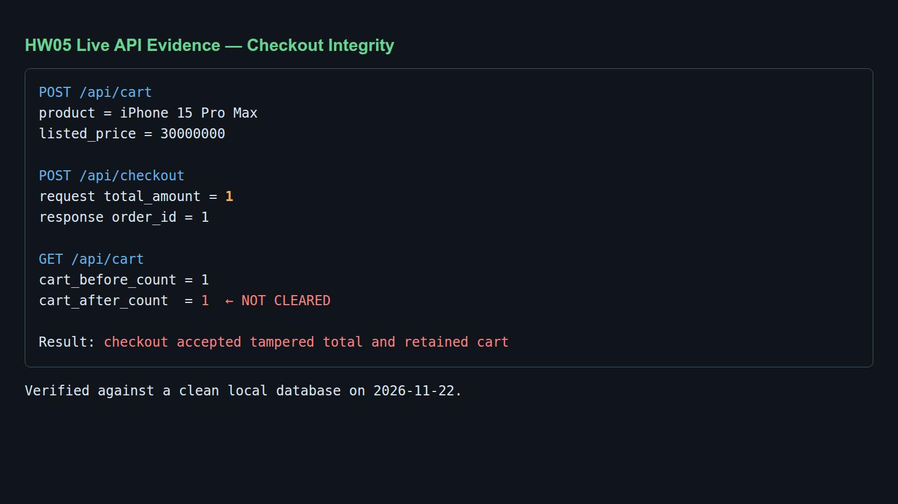

# [BUG] Checkout accepts a client-tampered total and leaves the cart uncleared

Published as [GitHub Issue #2](https://github.com/vinh-code/hw05-performance-testing-23120202/issues/2).

## Environment

- EShop backend, Node.js + Express + SQLite
- Clean database initialized on 2026-11-22
- User: `test@eshop.com`

## Steps to reproduce

1. Login and obtain a Bearer token.
2. Add one iPhone 15 Pro Max (`price: 30000000`) to the cart.
3. Send `POST /api/checkout` with `total_amount: 1`.
4. Read the created order and call `GET /api/cart`.

## Actual result

- Checkout succeeds and persists `total_amount: 1`.
- The cart still contains the purchased item after checkout.

## Expected result

According to FR-08 in `sut/README.md`, the backend must recalculate the total from cart contents and clear the cart after successful checkout.

## Evidence

- [Raw verification log](https://github.com/vinh-code/hw05-performance-testing-23120202/blob/main/evidence/api-checks/checkout-integrity-20261122.txt)
- [Evidence screenshot](https://github.com/vinh-code/hw05-performance-testing-23120202/blob/main/evidence/screenshots/06-checkout-integrity.png)
- Relevant implementation: `sut/backend/server.js`, checkout route

## Impact

The client can manipulate the payable amount, causing an order-integrity vulnerability. Retained cart entries also violate the functional requirement and can contribute to memory growth during repeated checkouts.
