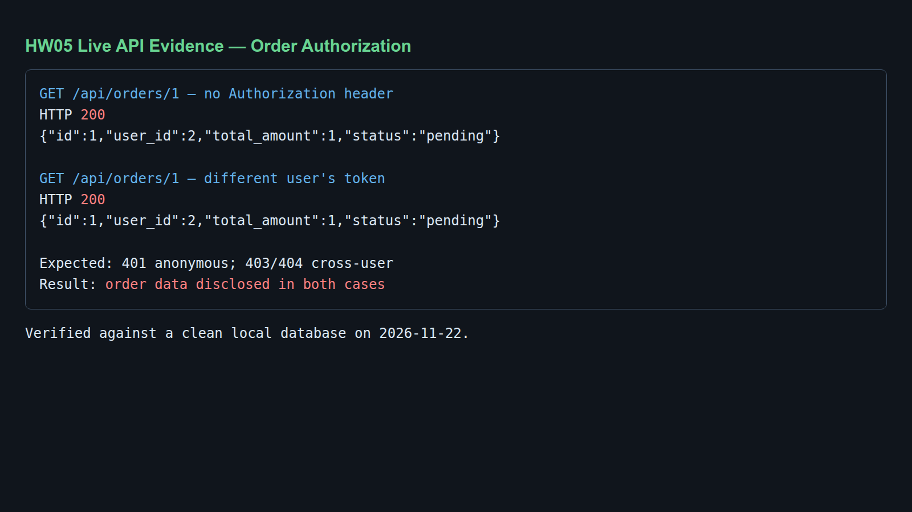

# [SECURITY] Order detail is accessible without authentication and across users

Published as [GitHub Issue #3](https://github.com/vinh-code/hw05-performance-testing-23120202/issues/3).

## Environment

- EShop backend, Node.js + Express + SQLite
- Clean database initialized on 2026-11-22
- Order created by user A; access repeated anonymously and as user B

## Steps to reproduce

1. Login as user A and create an order.
2. Send `GET /api/orders/{orderId}` without an Authorization header.
3. Login as a different user B and send the same request with user B's token.

## Actual result

Both requests return HTTP 200 and disclose user A's order data.

## Expected result

The Cart & Orders section of `sut/api_specification.md` requires `Authorization: Bearer <token>`. Anonymous access should return 401, and an authenticated user must not read another user's order.

## Evidence

- [Raw verification log](https://github.com/vinh-code/hw05-performance-testing-23120202/blob/main/evidence/api-checks/order-authorization-20261122.txt)
- [Evidence screenshot](https://github.com/vinh-code/hw05-performance-testing-23120202/blob/main/evidence/screenshots/07-order-authorization.png)
- Relevant implementation: `sut/backend/server.js`, `GET /api/orders/:id`

## Impact

An attacker can enumerate order IDs and disclose other customers' order data. This is an object-level authorization failure.
