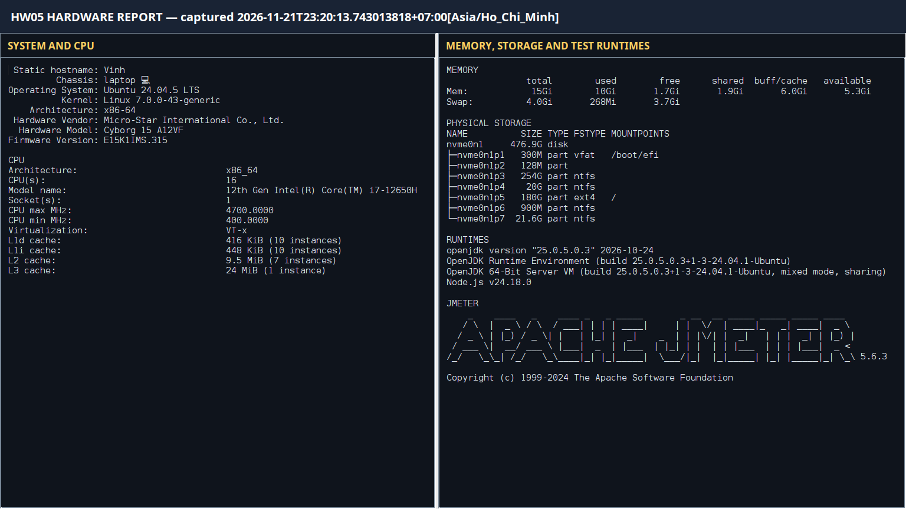
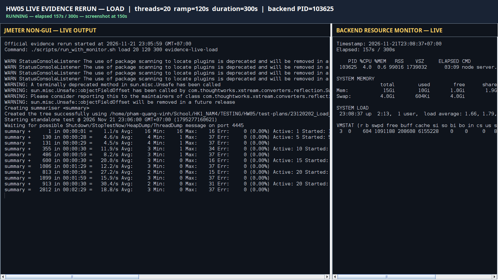
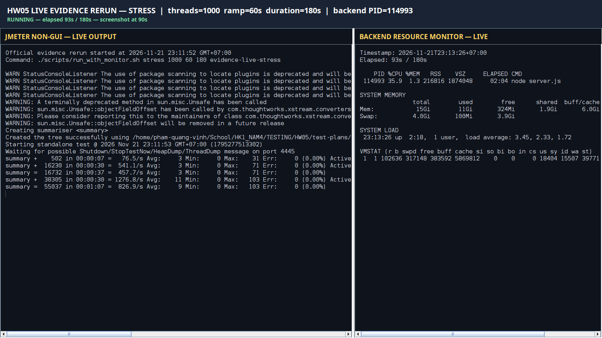
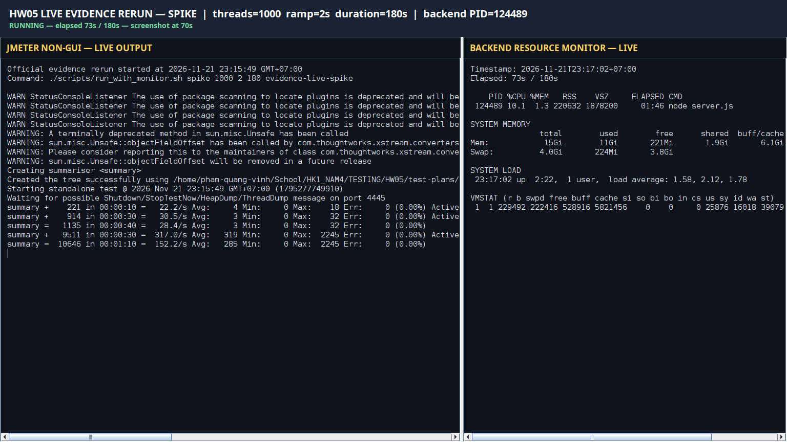
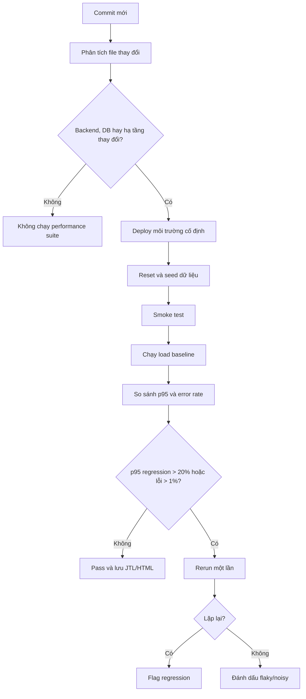

# HW05 – Performance Testing Report

**Sinh viên:** Phạm Quang Vinh  
**MSSV:** 23120202  
**Workflow:** Flow 4 – Cập nhật hồ sơ → Mua  
**Ngày thiết kế:** 2026-11-17
**Ngày chạy chính:** 2026-11-18

## 1. Phạm vi và môi trường

Workflow: Login → Get profile → Update profile → Search → Product detail → Add to cart → Checkout → Order detail.

| Thành phần | Cấu hình |
|---|---|
| Máy | MSI Cyborg 15 A12VF, hostname `Vinh` |
| CPU | Intel Core i7-12650H, 10 cores / 16 logical CPUs |
| RAM | 15 GiB |
| OS | Ubuntu 24.04.5, Linux 7.0.0-43-generic |
| Java | OpenJDK 25.0.5 |
| JMeter | 5.6.3 |
| Backend | Node.js 24.18.0, Express, SQLite |

JMeter và SUT chạy trên cùng máy. Vì vậy ngưỡng quan sát bao gồm cả chi phí của load generator, không phải benchmark backend cô lập. Thông số text nằm tại `evidence/hardware_spec.txt`; ảnh hardware được chụp lại ngày 2026-11-21:

Demo có giọng nói tiếng Việt và JMeter/resource monitor cùng khung hình: [YouTube Unlisted](https://youtu.be/tAsw4BRn0uI).

## 2. AI-assisted design và human review

AI hỗ trợ ánh xạ endpoint, tạo correlation, assertion, CSV, mô hình tải và script phân tích. Sau khi smoke test và endurance, test plan được sửa ở các điểm:

1. Mỗi virtual user dùng tài khoản CSV riêng thay vì dùng chung một account.
2. `product_id`, `product_name`, `product_price`, JWT và `orderId` được trích xuất từ response thay vì hard-code.
3. Spike có baseline, burst và recovery; không chỉ tăng tải rồi dừng.
4. Khi sampler lỗi, `startnextloop` được dùng để tránh `NOT_FOUND` tạo lỗi 400/403/404 dây chuyền.
5. Kết quả được phân tích theo cửa sổ 30 giây để không cho whole-run average che khuất degradation cuối endurance.

Chi tiết: `docs/test-design.md`.

## 3. Load test

- Test plan: `23120202_Load_20261117.jmx`
- Cấu hình: 20 users, ramp-up 120 giây, duration 300 giây
- Report view: Summary Report
- Raw log: `results/load/official_20261118_125540_20261118_125540.jtl`

| Metric | Kết quả |
|---|---:|
| Request samples | 7,392 |
| Throughput toàn run | 24.75 req/s |
| Average | 5.24 ms |
| p95 exact từ raw JTL | 15 ms |
| Error rate | 0.0000% |
| Backend CPU trung bình / tối đa | 8.03% / 15.00% của một core |
| Backend RSS tối đa | 87,452 KB |

Checkout là endpoint chậm nhất: average 14.35 ms, p95 19 ms. Load 20 users còn xa giới hạn phần cứng.

Ảnh evidence dưới đây được chụp live từ rerun cùng cấu hình ngày 2026-11-21, tại khoảng giây 150 khi JMeter vẫn đang chạy. Rerun có JTL/HTML/resource log riêng và không thay thế số liệu chính thức trong bảng trên.

## 4. Stress test

- Test plan: `23120202_Stress_20261117.jmx`
- Các nấc đã chạy: 60, 200, 500 và 1,000 users
- Kết quả stress đại diện: 1,000 users, ramp-up 60 giây, duration 180 giây
- Report view: Aggregate Report
- Raw log: `results/stress/calibration1000_20261118_131826_20261118_131826.jtl`

| Metric | Kết quả 1,000 users |
|---|---:|
| Request samples | 220,812 |
| Throughput toàn run | 1,232.12 req/s |
| Average | 28.80 ms |
| p95 exact từ raw JTL | 79 ms |
| Maximum | 1,466 ms |
| Error rate | 0.0000% |
| Backend CPU trung bình / tối đa | 49.96% / 77.00% của một core |
| Backend RSS tối đa | 218,404 KB |

Không có HTTP error trong stress ngắn. Tuy nhiên một cửa sổ full-load có average 67 ms và max 1,466 ms, cao hơn rõ rệt so với Load. Đây là degradation nhưng chưa phải crash/breaking point.

Ảnh evidence dưới đây được chụp live từ rerun 1.000 users ngày 2026-11-21, tại khoảng giây 90 sau ramp-up. Rerun có JTL/HTML/resource log riêng và không thay thế số liệu chính thức trong bảng trên.

## 5. Spike test

- Test plan: `23120202_Spike_20261117.jmx`
- Baseline: 20 users
- Burst: thêm 1,000 users tại giây 60 trong 30 giây, ramp 2 giây
- Tổng duration: 180 giây
- Report view: View Results Tree, chỉ giữ lỗi
- Raw log: `results/spike/official_20261118_132254_20261118_132254.jtl`

| Phase | Samples | Throughput | Average | p95 | Max | Errors |
|---|---:|---:|---:|---:|---:|---:|
| Pre-spike baseline | 1,617 | 28.23 req/s | 4.67 ms | 14 ms | 43 ms | 0 |
| Spike burst | 32,876 | 1,079.03 req/s | 207.96 ms | 1,084 ms | 1,933 ms | 0 |
| Immediate recovery, 10 giây | 2,392 | 240.47 req/s | 33.19 ms | 283 ms | 488 ms | 0 |
| Settled recovery | 2,487 | 30.56 req/s | 3.51 ms | 12 ms | 36 ms | 0 |

SUT không trả lỗi trong burst và trở lại gần baseline sau khoảng 10 giây. Spike làm p95 tăng từ 14 ms lên 1,084 ms nhưng không gây suy giảm kéo dài.

Ảnh evidence dưới đây được chụp live từ rerun ngày 2026-11-21 tại khoảng giây 70, trong burst 1.000 users. Rerun có JTL/HTML/resource log riêng và không thay thế số liệu chính thức trong bảng trên.

## 6. Endurance threshold

Ba mức được chạy trên database sạch, ramp-up 30 giây rồi giữ tải gần 10 phút:

| Users | Kết quả |
|---:|---|
| 800 | Ổn định khoảng 1,200 req/s đến giây 510; cuối run throughput 446.73 req/s, p95 4,540 ms và error cửa sổ 1.492% |
| 500 | Ổn định khoảng 760 req/s đến giây 570; cuối run throughput 441.10 req/s và p95 1,246 ms, không có lỗi |
| 300 | Ổn định toàn bộ; đoạn sustained khoảng 455–460 req/s, p95 mỗi cửa sổ 13–23 ms, 0 lỗi |

Kết quả 300 users:

| Metric | Giá trị |
|---|---:|
| Samples | 281,516 |
| Throughput toàn run, gồm ramp | 447.48 req/s |
| Throughput sustained | khoảng 457 req/s |
| Average | 4.79 ms |
| p95 exact toàn raw JTL | 16 ms |
| Max | 96 ms |
| Error rate | 0.0000% |
| Backend CPU trung bình / tối đa | 47.90% / 66.00% của một core |
| Backend RSS tối đa quan sát | 201,528 KB, khoảng 197 MB |

**Ngưỡng bền vững cao nhất đã xác nhận trong các mức được thử là 300 users, khoảng 457 sustained req/s trong 10 phút.** Biên thực tế nằm giữa 300 và 500 users trong môi trường này; chưa có phép tìm kiếm nhị phân để gọi 457 req/s là giới hạn tuyệt đối.

## 7. AI analysis và misinterpretation hunt

AI analysis ban đầu nằm tại `analysis/ai_initial_analysis.md`; human review tại `analysis/human_review.md`.

Các sửa chữa quan trọng:

1. HTML endurance 800 hiển thị p95 khoảng 1,863 ms do report generator dùng percentile window giới hạn. Exact p95 của toàn raw JTL là 582 ms. Cả hai đúng với phạm vi khác nhau; AI đã sai khi gọi HTML value là whole-run p95.
2. Error rate toàn endurance 800 chỉ 0.0428%, nhưng cửa sổ cuối là 1.492%. Whole-run average che khuất failure cuối run.
3. AI gọi SQLite là root cause đã xác nhận. Evidence chỉ cho phép nói đây là giả thuyết: latency tăng khi CPU backend giảm và I/O wait khoảng 5%, nhưng chưa có profiler/SQLite trace.
4. AI gọi RSS tăng là memory leak. RSS có các lần giảm do GC; chỉ có thể ghi nhận memory growth/ceiling quan sát, chưa chứng minh leak.
5. AI gọi 300 users là maximum tuyệt đối. Human review sửa thành highest verified stable tested level; biên 300–500 vẫn chưa được thu hẹp.

## 8. Đánh giá khuyến nghị tối ưu

| Khuyến nghị AI | Đánh giá | Lý do |
|---|---|---|
| Bật SQLite WAL và A/B test | Khả thi để thử | Workflow vừa đọc vừa ghi; cần benchmark lại, không bảo đảm sửa được single-writer bottleneck |
| Thêm database index chung chung | Chưa có cơ sở | Insert order là write path chính; index bổ sung có thể làm write đắt hơn. Search dùng `LIKE '%keyword%'`, B-tree thường không giải quyết leading wildcard |
| Thêm connection pool SQLite | Không được chứng minh | SUT dùng một kết nối `sqlite3`; pool không loại bỏ giới hạn một writer và có thể tăng lock contention |
| Xóa cart sau checkout | Khả thi và cần thiết | Đặc tả yêu cầu cart được xóa, nhưng backend hiện giữ item trong `userCarts`; vừa là bug chức năng vừa gây tăng dữ liệu in-memory |
| Cache product read | Khả thi nhưng tác động hạn chế | Có thể giảm read cost, nhưng không trực tiếp xử lý write degradation của checkout |
| Chuyển PostgreSQL | Khả thi dài hạn, chi phí cao | Có concurrency tốt hơn nhưng là thay đổi kiến trúc; cần profiling và benchmark trước khi quyết định |

## 9. Continuous Performance Testing proposal

Suite ngắn chạy trên pull request; endurance chạy theo lịch hoặc trước release. Rerun giúp giảm false alarm nhưng làm tăng chi phí. Baseline chỉ có ý nghĩa khi cùng phần cứng, dữ liệu, runtime và think-time. p95 phải được so sánh theo cùng phạm vi; không trộn exact whole-run percentile với HTML sliding-window percentile.

## 10. Bugs/performance issues

Performance issue đã được đăng tại [GitHub Issue #1 – Throughput collapses late in sustained checkout workload](https://github.com/vinh-code/hw05-performance-testing-23120202/issues/1). Evidence trực quan nằm tại `evidence/screenshots/05-endurance-degradation.png`; nội dung nguồn được lưu tại `issues/ISSUE-001-endurance-degradation.md`.

## 11. Hạn chế

- Load generator và SUT dùng chung máy.
- Resource evidence gồm log text (`pidstat`, `vmstat`) và ảnh live cùng khung hình cho Load, Stress, Spike; video giọng nói đã được đăng ở chế độ YouTube Unlisted.
- Ngưỡng chỉ được kiểm tra tại các mức rời rạc 300, 500 và 800 users.
- Nguyên nhân degradation chưa được xác nhận bằng profiler hoặc tracing SQLite.

## 12. Kết luận

Flow 4 chạy ổn định ở Load 20 users. Stress 1,000 users và Spike 1,000-user burst không gây crash, nhưng làm latency tăng rõ rệt. Endurance chứng minh mức 500 và 800 users không bền vững đủ 10 phút, trong khi 300 users duy trì khoảng 457 req/s, p95 exact 16 ms và 0 lỗi. Đây là mức ổn định cao nhất đã xác nhận trong bài, không phải tuyên bố về giới hạn tuyệt đối của backend.

