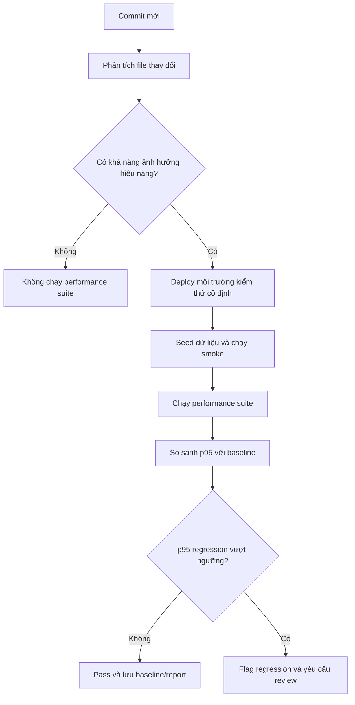

# HW05 – Performance Testing Report

**Sinh viên:** Phạm Quang Vinh  
**MSSV:** 23120202  
**Workflow:** Flow 4 – Cập nhật hồ sơ → Mua  
**Ngày thiết kế ban đầu:** 2026-11-17

> Trạng thái: bản làm việc. Các mục đánh dấu `CHƯA CÓ BẰNG CHỨNG` không được dùng làm kết luận cuối.

## 1. Phạm vi và môi trường

Workflow: Login → Get profile → Update profile → Search → Product detail → Add to cart → Checkout → Order detail.

### Cấu hình phần cứng

`CHƯA CÓ BẰNG CHỨNG – chạy scripts/collect_hardware.sh và chụp resource monitor.`

## 2. AI-assisted test design và human review

Xem [test-design](../docs/test-design.md). AI được dùng để đề xuất cấu trúc, correlation, assertion và mô hình tải. Sinh viên đã đối chiếu với mã nguồn SUT và sửa các vấn đề được ghi tại phần Human review.

## 3. Load test

- Test plan: `23120202_Load_20261117.jmx`
- Report view: Summary Report
- Trạng thái: `CHƯA CHẠY CHÍNH THỨC`

| Metric | Giá trị |
|---|---:|
| Throughput | TBD từ JTL |
| Average | TBD từ JTL |
| p95 | TBD từ JTL |
| Error rate | TBD từ JTL |

## 4. Stress test

- Test plan: `23120202_Stress_20261117.jmx`
- Report view: Aggregate Report
- Trạng thái: `CHƯA CHẠY CHÍNH THỨC`

Breaking point: `TBD – không suy đoán trước khi chạy.`

## 5. Spike test

- Test plan: `23120202_Spike_20261117.jmx`
- Report view: View Results Tree, giới hạn lưu lỗi
- Trạng thái: `CHƯA CHẠY CHÍNH THỨC`

Khả năng phục hồi sau spike: `TBD`.

## 6. Endurance threshold

`CHƯA CHẠY`. Phải báo cáo tải duy trì, thời lượng 10–15 phút, RPS ổn định, p95, error rate, CPU và memory ceiling.

## 7. AI analysis và misinterpretation hunt

`CHƯA THỰC HIỆN – cần raw JTL chính thức.`

Mỗi nhận định sai của AI sẽ được đối chiếu bằng giá trị và dòng/dữ liệu tính lại từ raw JTL.

## 8. Đánh giá khuyến nghị tối ưu

`CHƯA THỰC HIỆN – chỉ đánh giá sau khi có bottleneck quan sát được.`

## 9. Continuous Performance Testing proposal

Pipeline chỉ chạy khi commit chạm backend, database migration hoặc cấu hình hạ tầng để giảm chi phí. So sánh nên dùng nhiều lần chạy hoặc tolerance band thay vì một giá trị đơn, vì nhiễu máy, warm-up và tác vụ nền có thể tạo false alarm. Baseline phải gắn với cùng phần cứng, dữ liệu và phiên bản runtime. PR chỉ nên bị chặn khi regression lặp lại; một cảnh báo đơn lẻ nên được rerun trước.

## 10. Bugs/performance issues

Chỉ ghi issue đã tái hiện và có ảnh/raw log. `CHƯA CÓ ISSUE HIỆU NĂNG ĐƯỢC XÁC NHẬN`.

## 11. Kết luận

`TBD sau khi hoàn thành các lần chạy thật.`

